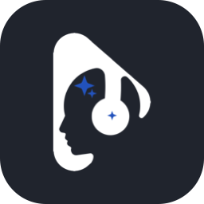

<div align="center">



# VoiceiQ

**Press a key. Speak. It types.**

Smart dictation and meeting notes for macOS and iPhone, on AssemblyAI with your own key.

</div>

---

## What it is

Press the dictation key, say the thing, press it again. A moment later your
words are in the app you were already using — punctuated, filler words removed,
lists laid out as lists, mid-sentence corrections applied. No window to switch
to, no transcript to copy, no account to make.

It is deliberately small: a menu bar icon, a pill at the bottom of your screen
while you talk, and a History window that proves nothing was ever lost.

## Keys

| Key | What happens |
| --- | --- |
| **Dictation key** (default `fn`) | One press starts, one press finishes. Hands-free, no holding. A bare modifier, a combination like ⌥D, or the middle mouse button held for half a second. |
| **⌘Esc** | Cancels. A bare `Esc` goes to the app you are in. After 10 seconds of recording it asks for a second ⌘Esc first, and the cancelled take is still kept in History. |
| **⌥M** | Start or stop meeting notes. |
| **⌘⇧V** | Paste the last transcript again. |

Every key is editable in Settings → Dictation, and a shortcut can require the
left or the right modifier only.

## What makes it different

**It follows a change of mind.** Say *"let's meet at 1pm — actually, no, make it
2pm"* and VoiceiQ writes **"Let's meet at 2pm."** That is the whole pitch, and
onboarding makes you do it once so you believe it.

**It never loses your words.** Audio goes to disk from the first millisecond, so
a crash, a `kill -9`, or a flat battery costs you nothing — the recording is
recovered on next launch. Offline, dictations queue and land when you reconnect.
Every failure is retryable from History, and Retry transcribes any dictation again. Release the key mid-word and it keeps
listening until you actually stop.

**It is private by architecture.** Your voice goes from your Mac straight to
AssemblyAI with *your* key. No middleman server, no account, no
analytics, no keystroke logging — one provider, and you can read every
line of the code that talks to it. Each dictation also sends the app, window
and page you are in and the text around the cursor, so the dictation fits
what is already in the field. Screen context (the text in the window you dictate into, read
on the Mac while you speak and sent with each dictation so on-screen names and
paths are spelled right; no image is sent) can be switched off in
Settings → Dictation.
See [PRIVACY.md](docs/PRIVACY.md).

**Your jargon, spelled right.** Names and product terms go in the Dictionary,
and the writing model spells them as you wrote them there, so "cooper netties"
comes out as "Kubernetes". Fix a word
after VoiceiQ types it and the correction is learned into the Dictionary on its own. The
Dictionary syncs between the Mac and iPhone through your iCloud account, and the
iPhone keyboard adds a selected or copied word in one tap.

**It writes the way you meant it.** AssemblyAI's STT-3.7 transcribes the
dictation while you speak, then GPT-6 Luna on AssemblyAI's LLM Gateway writes
the text by the built-in writing rules: "scratch that", "change the
first point to…" and other mid-dictation instructions become edits, grammar is
fixed, run-on speech gets sentence breaks, and your own rules from Settings →
Dictation are applied. Spelling follows your Mac's region (en-GB, en-IN or
en-US, for example). Dictate for as long as you like; there is no time limit.
English is the default language; Settings → Dictation → Language picks
another of STT-3.7's 32 languages (or detects among them, mixing included),
or a language such as Tamil that only Universal-2 has, which is transcribed
after you stop and takes a few seconds longer. If the writing step fails, or
the account has no balance for the LLM Gateway, the transcript goes in tidied
on the device and the pill says so.

**Stays out of your way.** Other audio is muted while you dictate and restored
after (switch it off in Settings → Dictation). Pick a preferred microphone or
leave it on system default and get a one-time notice when a new one appears.

**Meeting notes.** When Zoom, Teams, FaceTime, WhatsApp, Slack, Discord,
Webex, or a Meet/Teams/Zoom tab in any browser starts a call, the pill offers to
record it. Accept, or press ⌥M at any time, and VoiceiQ records both sides.
Press ⌥M again (or the pill's stop button) to finish: you get a
speaker-labelled transcript plus a summary, decisions, and owned action items
under Settings → Meetings. Recording never stops on its own. There is no live
transcript while it records; the transcript is written when you stop.
With no usable key the recording is kept and marked failed with the reason,
ready to Retry once a key is added.

**Cost Analysis.** Every model call is metered: audio hours and tokens,
priced at AssemblyAI's list prices. Settings → Cost Analysis shows today, this week, this month, and all
time, broken down by action and by model, for AssemblyAI (Gemini, OpenAI, ElevenLabs and
Claude get a row only while History still holds calls booked to them from
when they were providers); each dictation in History shows what it cost. Details in
[docs/COST_TRACKING.md](docs/COST_TRACKING.md).

## Setup

Build the app (see Development below), move `VoiceiQ.app` into
**Applications**, and launch it. Setup takes about two minutes and the app walks
you through it:

1. **Paste an AssemblyAI API key** — [sign up](https://www.assemblyai.com/dashboard/signup)
   (no card; $50 of free credit) and copy the key from
   [the dashboard](https://www.assemblyai.com/dashboard/api-keys). The key is stored
   in your macOS Keychain and only ever sent to AssemblyAI. You can change it
   later in Settings → Advanced.
2. **Allow the microphone** — say hello and it advances by itself.
3. **Allow Accessibility** — macOS requires this for any app that types into
   another app.
4. **Allow Screen Recording** (optional) — lets VoiceiQ read the text on your
   screen while you dictate so on-screen names and paths are spelled right.
5. **Press the dictation key and talk.**

**Cost:** you pay AssemblyAI, at [AssemblyAI pricing](https://www.assemblyai.com/pricing).
A 20-second dictation costs about ₹0.24 with GPT-6 Luna writing it; a meeting
about ₹28 per hour of speech. The free credit covers speech-to-text but not
the LLM Gateway, so the writing step, meeting notes and meeting chat need a
small balance on the account; without it dictations go in as heard, tidied.
VoiceiQ itself is free and has no account.

**Models:**

| | Model |
| --- | --- |
| Dictation transcript | STT-3.7 Realtime, streamed while you speak (pre-recorded STT-3.7, or Universal-2, when the stream fails or for languages STT-3.7 lacks) |
| Dictation writing | `gpt-6-luna` on the LLM Gateway |
| Meeting transcript and speakers | STT-3.7 per track, with speaker labels |
| Meeting notes and meeting chat | `gpt-6-luna` on the LLM Gateway |

The writing model never hears the audio: it gets the transcript, with any
screen text, and writes the text.
Dictation can also be transcribed on device with Fluid Speech
Pro or Mini by FluidVoice. Their transcripts are then written by AssemblyAI, or,
with writing Off, tidied on the device by rules with no model; see
[docs/ON_DEVICE.md](docs/ON_DEVICE.md).
Settings → Advanced can pin another writing model ("Writing model").

## How it works

```
key ─▶ capture (CAF on disk from t=0) ─▶ key ─▶ transcript ─▶ gpt-6-luna
          │                                        ▲      (LLM Gateway: writes;
          └─▶ STT-3.7 Realtime, while you speak ───┘       screen text)
              (stream failed: FLAC ─▶ pre-recorded STT-3.7)     │
   cursor ◀─ insert (AX → paste → clipboard) ◀─ dictionary replacements
      │                                                         │
      ▼                                                         ▼
   learn from edits ─▶ Dictionary                  History (SQLite) + usage ledger
```

A few decisions worth knowing about, because they are what make it feel solid:

- **The capture graph is pre-warmed while idle**, so a key press only pays
  `engine.start()` — 20-40ms instead of 75-150ms. Preparing is not recording: no
  audio flows and no mic indicator appears until you actually hold the key.
- **The mic drains one buffer past the stop**, because the audio tap only
  delivers whole ~100ms chunks and tearing down immediately threw away the tail
  of your last word.
- **Insertion is a ladder**: Accessibility API first (no clipboard involved), then
  a guarded paste that restores your clipboard, then a "copied — press ⌘V" chip.
  It never blind-pastes into an app that stole focus mid-flight.
- **The answer is structured.** The model returns JSON `{"text": ...}`, which
  keeps its working out of the inserted text, and the prompt has it write
  down a spoken instruction rather than obey it.
- **The paths that can lose words are tested.** `VoiceIQCore` is a headless Swift
  package holding the state machine, hotkey grammar, audio, transcription,
  formatting, insertion and history — so the failure modes above are exercised
  without launching the app.

The full design specs — including the failure matrix the reliability work is
built from — are in [docs/design/](docs/design/).

### Coding agents

Turn on Settings › Advanced › Coding agents and Claude Code, Codex, Amp and
other MCP clients on the Mac can list and search your dictations and meetings
(notes, transcripts with speakers and times, and questions), including the
ones synced from your iPhone. VoiceiQ adds itself to Claude Code, Codex and
Amp's own config when they are installed. It is read-only, listens on 127.0.0.1 only and
needs an access key. Setup, tools, routes and security are in
[docs/AGENT_ACCESS.md](docs/AGENT_ACCESS.md).

## iPhone

VoiceiQ also ships as an iPhone app (iOS 18+) with its own keyboard. Add the
VoiceiQ keyboard with Full Access, tap the mic in any app, and the text lands
where you were typing.

- **A keyboard for your voice.** Dictate in one tap, plus a panel that moves
  the cursor, copies, pastes and undoes. Type with your usual
  keyboard; the globe key switches between them (docs/IOS.md, "Keyboard").

- **One trip to the app, once.** The first tap starts a background session and
  sends you back to the app you were in. After that the mic starts in place,
  and the session shows in the Dynamic Island until you end it.
- **Same settings as the Mac.** AssemblyAI with your own key (stored in the iOS
  Keychain, under Settings › API Key), dictionary, writing rules, History and
  Cost.
- **Meetings are a recorder (Notes on iPhone).** Record in the app, stop, and the notes are
  written with the same pipeline as on the Mac. The iPhone records the room
  mic only, because iOS does not let an app capture call audio.

It is distributed through TestFlight as "VoiceiQ Dictation". Details in
[docs/IOS.md](docs/IOS.md).

## Development

Requires macOS 14+ to run, Xcode 27+ with the iOS 27 SDK to build, and
[xcodegen](https://github.com/yonaskolb/XcodeGen). The `.xcodeproj` is
generated from `project.yml`, not checked in. One project holds both apps:
`VoiceIQ` (macOS) and `VoiceIQiOS` with its `VoiceIQKeyboard` and
`VoiceIQLiveActivity` extensions. All of them build on the `VoiceIQCore`
package; the extensions link only its small `VoiceIQBridge` library.
The Mac's `VoiceiQLocalSpeech` helper links `VoiceIQInference` so downloaded
on-device speech, speaker separation, and writing models run outside the UI
process.

```bash
brew install xcodegen
./scripts/test.sh           # swift test on VoiceIQCore (shared by both apps)
./scripts/build.sh          # macOS app, Debug
./scripts/build-ios.sh      # iPhone app, keyboard and Live Activity (Simulator)
open VoiceIQ.xcodeproj      # or work in Xcode
```

Debug builds sign ad-hoc, so a clean clone needs no Apple account, certificate,
or team membership. To build under your own team instead:
`./scripts/build.sh DEVELOPMENT_TEAM=XXXXXXXXXX`, or for an iPhone
`./scripts/build-ios.sh DEVICE=1 DEVELOPMENT_TEAM=XXXXXXXXXX`. Only release
builds need the team's signing material.

Code shared by both apps lives in `VoiceIQCore`. Mac-only code (event taps,
Accessibility insertion, screen capture, system audio) is wrapped in
`#if os(macOS)`, and the iPhone gets small stand-ins in files ending `+iOS`.
CI builds both apps on every pull request.

```
App/            menu bar item, HUD pill, windows, design tokens, icon + sounds
iOS/            iPhone app, voice keyboard extension, Live Activity
VoiceIQCore/        all engine logic, headless and testable
  HotkeyEngine/     CGEventTap + the pure hold/lock/cancel grammar
  AudioEngine/      crash-safe CAF capture, device changes, prewarming
  TranscriptionClient/  AssemblyAI calls, realtime stream, retries, FLAC
  FormattingPipeline/   dictation prompt, writing rules, dictionary replacements
  InsertionEngine/      the AX → paste → clipboard ladder
  HistoryStore/         GRDB index, recovery, retry queue, retention
  MeetingEngine/        call detection, mic + system audio taps, diarized notes
  AgentAccess/          local API and MCP server for coding agents (Mac)
  ScreenContext/        on-device OCR of the screen on app switch, for spelling
  Learning/             dictionary auto-learn from your edits
  Usage/                token metering, price book, cost ledger
  Bridge/               VoiceIQBridge: keyboard ↔ app protocol, return-link table
scripts/        build, test, icon, DMG, macOS and iOS release
docs/           privacy, releasing, cost tracking, design specs, research
```

Useful while hacking:

```bash
# every surface is reachable headlessly
open "voiceiq://settings/about"      # or /dictation /privacy /advanced /meetings /cost
open "voiceiq://history"  "voiceiq://dictionary"  "voiceiq://onboarding/5"

# watch it work
log show --last 5m --info --predicate 'subsystem == "io.blue.voiceiq"'
```

Transcript text is logged as `private` and never appears in those logs.

### Releasing

| | macOS | iPhone |
| --- | --- | --- |
| Command | `./scripts/release.sh` | `./scripts/release-ios.sh` |
| Signing | Developer ID Application | Apple Distribution + three App Store profiles |
| Output | Notarized, stapled DMG and ZIP in `build/release/` | Build on TestFlight ("VoiceiQ Internal") |
| Publish | `./scripts/publish-github-release.sh`: GitHub Release with the Sparkle appcast | Automatic to the internal group |
| Credentials | `APPLE_ID`, app-specific password, team ID | asc API key (`scripts/setup-asc.sh`, once) or a signed-in Xcode |

Pushing a new `MARKETING_VERSION` (and a higher `CURRENT_PROJECT_VERSION`) in
`project.yml` to `main` runs both scripts in GitHub Actions and publishes both
apps with AI-written release notes ([docs/UPDATES.md](docs/UPDATES.md)). Both
scripts run the `VoiceIQCore` tests first and refuse to publish anything whose
signature or entitlements fail verification. The full
process, one-time setup and checks are in
[docs/RELEASING.md](docs/RELEASING.md).

## License and attribution

VoiceiQ is based on [Jot](https://github.com/google-gemini/jot-gemini-transcribe-macOS),
Copyright 2026 Google LLC, and is distributed under the Apache License 2.0
([LICENSE](LICENSE)). Changes since the fork are by Blue Lobster Technology.
Third-party components and their licenses are listed in
[THIRD_PARTY_NOTICES.md](THIRD_PARTY_NOTICES.md). This is not an officially
supported Google product.
